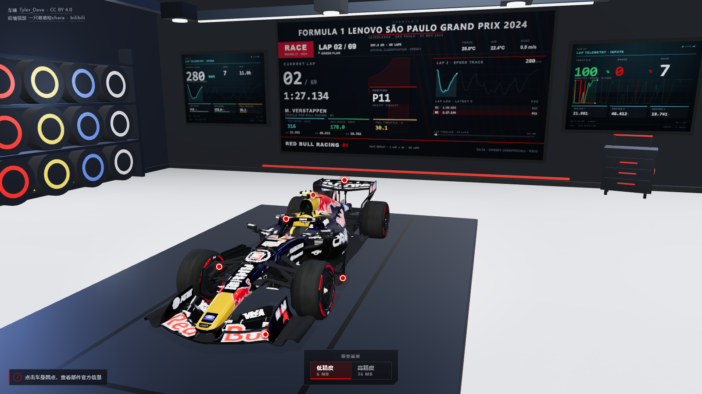
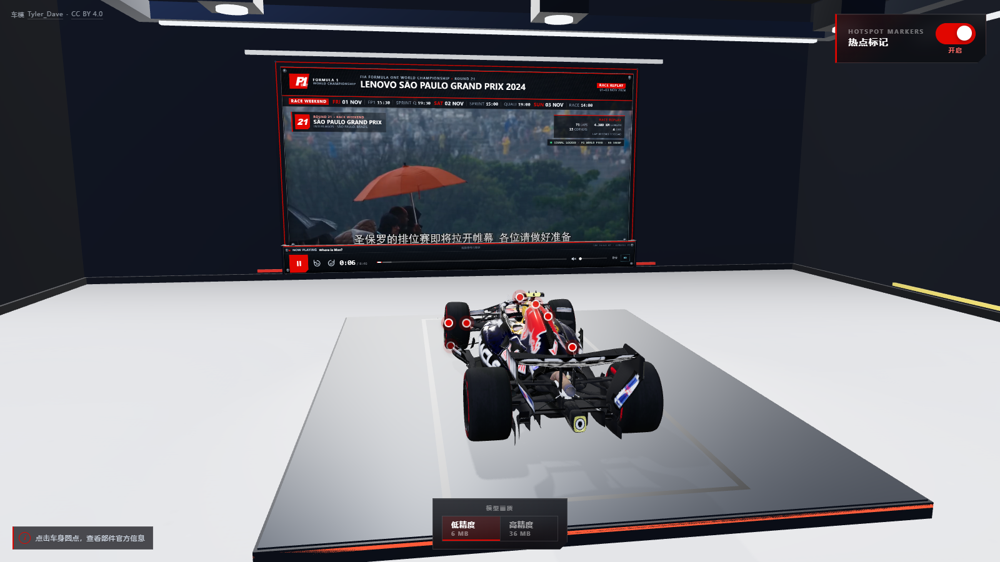

# RB22 · Web3D

**浏览器里的 F1 赛车 3D 展示页**：加载红牛 RB22（2026 赛季）车模，360° 拖拽旋转，
点击车身部件弹出科普信息卡。个人作品集 / 学习项目。[预览地址:www.mj1nk9.com](www.mj1nk9.com)

[](https://vuejs.org/)
[](https://threejs.org/)
[](https://www.typescriptlang.org/)
[](https://vite.dev/)
[](#ai-coding-说明)



*后墙三屏：2024 巴西圣保罗大奖赛正赛逐圈回放（69 圈官方遥测，每圈 4s）。*

---

## 这是什么

一个纯前端的 Web3D 单页应用。打开页面后：

1. 低精度车模带着进度条加载（6.6 MB），进入一间程序化生成的「车队工房」展示间；
2. 鼠标 / 手指拖拽可以 360° 环绕赛车，滚轮 / 双指缩放，镜头甚至可以沉到车底；
3. 车身 8 个部件上有发光圆点，点击弹出该部件的科普卡片（标题、正文、规格、出处）；
4. 右上角开关可以一键隐藏所有热点，回到纯展示模式；
5. 切到高精度模型时播放一段完整的换模动画：升降台载着车沉下去、下降一半时台前亮起
   「车辆切换中」的全息提示（含加载进度）、车到底后两扇地板合拢、加载完成并停满 2 秒后
   地板打开、新车随台面升回齐平位置，最后显示「切换成功」并恢复热点；
6. 绕到车的另一侧（约 180°），正前方墙上是一块 8.18 × 4.6 的 16:9 视频大屏：本地
   `Ver2024.mp4` 静音循环播放，画面满铺、不叠任何标题条；屏幕下方是一块**钉在墙上的
   3D 控制台**，播控面板贴在台面前表面，负责播放 / 暂停、拖动进度、时间码、静音和音量；
   屏幕进入视锥才开始加载，失败只回退海报。

**它解决的不是「放一个 3D 模型」**，而是三个具体问题：

- 35.8 MB 的未压缩车模如何在浏览器里稳定加载、居中、取景；
- 28 万三角形不能每帧 raycast，热点拾取如何做到不拖慢渲染；
- 没有 HDRI、没有美术资源，如何只用基础几何 + canvas 贴图搭出有层次的展厅。

---

## 功能一览

| 模块 | 能力 |
| --- | --- |
| 车模 | GLTF 加载、真实进度、包围盒居中、按包围球自动取景、各向异性过滤 |
| 画质 | 默认低精度（6.6 MB）；高精度（36 MB）按需加载，底部居中切换；手机与窄屏同样先给低精度 |
| 换模动画 | 升降台下降（50% 淡入全息）→ 地板合拢 → 全息进度（最短 2s）→ 地板滑开 → 车辆升起 → 切换成功提示；失败可重试 / 回滚 |
| 相机 | OrbitControls、360° 方位、可沉到车底、距离限位、阻尼；默认机位留出前翼，整车完整入画 |
| 热点 | CSS2D 圆点（真实 `<button>`）、隐形代理球 Raycaster、拖拽阈值、背向淡出、全局淡入淡出 |
| 信息卡 | 跟随投影、贴边收位、上方放不下自动翻到下方、窄屏贴底抽屉、Esc / 空白关闭 |
| 展示间 | 13.6 × 13.6 封闭工房：环氧地坪、后墙三屏遥测墙（居中主屏 + 左右副屏）、灯桁架、轮胎墙、工具墙 |
| 遥测屏 | 主屏顶部赛事字标（SÃO PAULO GRAND PRIX 2024）+ 2024 圣保罗正赛（69 圈）逐圈回放：每 4s 一圈，圈数 / 圈速 / 名次 / 速度曲线；左副屏速度 + RPM，右副屏油门 / 刹车 / 挡位 / 三段用时；第 33 圈红旗 |
| 前墙视频大屏 | 车头正前方 8.18 × 4.6（16:9 原生画幅）大屏，本地 `Ver2024.mp4` 静音自动播放 + 循环；画面满铺、不压标题条 / ticker / 车手条；屏幕下方真实 3D 控制台：播放 / 暂停、±10s、可拖动进度、当前 / 总时长、静音 + 音量滑块；懒加载，失败回退海报 |
| 光照 | SpotLight 光池 + RoomEnvironment 环境反射 + 阴影 + 雾 |
| 兜底 | WebGL 2 预检、加载进度、解析提示、失败原因 + 重新加载、显卡上下文丢失提示 |
| 开发工具 | `?pick` 取点、`?view=video` 前墙视频视角、`preview.html` 无车模布景预览（不进生产包） |
| 适配 | `prefers-reduced-motion`、窄屏抽屉、resize 自适应 |

热点覆盖：**Halo、前翼、尾翼、动力单元、轮胎、悬挂、底板、车底木地板（防滑块）**。

---

## 换模动画：低精度 → 高精度

这不是「删掉旧车、加载新车」，而是一段有明确状态机的舞台动作。状态顺序是硬约束：

```
低精度展示中 → 下降中（50% 淡入全息）→ 闸口关闭中 → 高精度加载中
             → 闸口打开中 → 升起中 → 切换成功提示 → 高精度展示中
```

| 阶段 | 画面 | 实现要点 |
| --- | --- | --- |
| 下降中 | 热点同步淡出，车随台面沉入井底；下到一半时「车辆切换中」全息淡入 | 台面下降 2.3；圆点在 0.26s 内整体淡出；全息是 DOM 覆盖层，屏幕空间固定在展台前端中心 |
| 闸口关闭中 | 车完全到底后，两扇地板从左右滑向中线、在中间合缝 | 开口 1.8 宽、每扇滑 0.94 进台沿下的口袋；合拢后完全盖住升降口 |
| 高精度加载中 | 全息持续显示「车辆切换中」+ 扫描线 / 粒子 + 进度条 | 速度模型：真实下载进度 + 时间保底曲线驱动，限速逼近、越近越慢；加载完成时目标切到 100%，同一套曲线连续收尾，不会硬停在 90% 再跳一下 |
| 闸口打开中 | 全息满 2s 后淡出，两扇地板朝两侧滑开；井底已经停着装好的新车 | 加载完成 + 进度 100% + 全息满 2s 三个条件都满足才开闸；新车在闸口关着时已挂好并渲染过两帧 |
| 升起中 | 新车随台面回到齐平位置 | 结束强制吸附到 `surfaceY`，接缝由一圈深色嵌条压住 |
| 切换成功 | 同一位置显示「切换成功」，固定留存 1s | 淡出后才重新挂载并淡入热点 |

几个容易踩的点，代码里都已经处理：

- **重复点击**：只有 `idle` 能发起切换，动画期间控件 `disabled`，不排队也不打断；
- **加载失败**：闸口保持关闭、车停在井底，全息收起，底部出现「重试 / 返回低精度」；
  返回时按反向流程重新载入原档再开闸升起；
- **热点**：下降开始即淡出、切换成功提示结束才挂载；圆点坐标依赖模型世界矩阵，
  所以只会在台面归位后重建，不会出现动画中的悬浮错位；
- **全息定位**：DOM 覆盖层 + 屏幕空间锚定，不随相机视角、车辆旋转、升降台移动，
  层级永远高于闸口和地板；同一位置复用于「切换成功」提示；
- **开口尺寸**：1.8 宽只比车宽（1.41）多 0.39，是为了让两扇地板（各 0.9）
  能滑进左右各 1.0 的台沿口袋；开口再宽，展台就得做到 5.8 宽才收得下门板。
- **接缝**：台面比开口单边小 6 mm，上面压一圈 0.05 宽的深色嵌条，
  台面与展台共用同一组材质参数，升起后是一条机加工缝而不是一道黑缝；
- **内存与「消失」**：旧车模一直留在井底，直到新车加载完成、在闸口关着的时候挂上同一位置，
  两车在同一帧里交换、旧车随即 `dispose`。正常视角有闸口遮着，车底视角也不会看到空井；
  下载与下降并行，但不会两套 4K 贴图同时挂在场景里。
- **新车就位**：新车挂上后再渲染两帧（贴图上传 / 着色器编译），闸口才打开——
  开门那一刻井底已经是一台完整的车，不会出现「门开了才加载出来」。

想验证失败态：把 `public/models/rb22.glb` 临时改名（或断网）再点「高精度」，
闸口会停在关闭状态，底部出现「重试 / 返回低精度」。

---

## 车头前墙视频大屏：本地 `Ver2024.mp4`



车头正前方（+Z 墙面）是一块 **8.18 × 4.6** 的视频大屏：按 16:9 取到前墙能容纳的
最大高度（y 0.6–5.2），顶边贴着墙顶、底边压住控制台，左右留出的深色墙面与机房
背景融在一起。它贴在前墙 `z ≈ 6.76`（屏幕面 6.74），相机最远只能到约 6.4，所以永远在车、
升降台、闸口、热点标记、全息提示和左右副屏之后，不会遮挡车辆主体 / 前翼，
也不会穿进墙体或场景模型。

**视频源是本地文件，不引用外链**：

- 文件：`public/videos/Ver2024.mp4`（源文件放在 `dist/videos/Ver2024.mp4`，
  由项目复制到 `public/videos/` 作为 Vite 的静态资源；`dist/` 是构建产物，不直接引用）
- 规格：1280 × 720、H.264 + AAC、30 fps、8:46、约 66 MB
- 页面里只写相对路径 `videos/Ver2024.mp4`（`VIDEO_SCREEN_CONFIG.src`），
  dev / build 都由 `BASE_URL` 拼接，没有任何 B 站 iframe 或外部 URL

**为什么不用 iframe**：同源本地文件可以直接读写 `<video>` 的
`currentTime / paused / volume / muted`，所以播放 / 暂停 / 拖动 / 音量都是真实状态，
不存在「父页面拿不到状态、只能重载播放器去猜」的问题。视频贴到屏幕上是
`VideoTexture`，播控面板驱动的是同一个 `<video>` 元素，音画天然同步。

**屏幕与「墙装控制台」**（[`src/ui/VideoScreen.vue`](src/ui/VideoScreen.vue) /
[`src/ui/projectedQuad.ts`](src/ui/projectedQuad.ts)）：

- 屏幕不是裸视频面：四周有墙面安装板、加厚边框、四角固定螺钉和 F1 红饰线；
  屏幕正下方是一块**真实的 3D 控制台**（0.5 高、0.16 深，带金属端盖和红色台沿），
  不是浮在画面上的 DOM 条；
- 屏幕上是**未经遮挡的原始画面**：8.18 / 4.6 与 1280 × 720 同为 16:9，视频按 cover
  满铺整块屏，不叠标题条、ticker、车手条或信号状态；雨战画面本身就是这里的视觉主体；
- 播控面板每帧读取控制器给出的「控制台前表面四角投影」，用 8 自由度单应矩阵
  贴到 3D 台面上，四条边和真实台面严格重合；相机绕车旋转时面板会跟着透视，
  不是固定 HUD；
- 播放 / 暂停、后退 10s、前进 10s、原生 `<input type="range">` 进度条
  （带已缓冲区间）、静音 + 音量滑块 + 百分比；拖动进度时每次 `input` 都直接
  `seek()`，视频画面实时跟随；时间码用等宽数字；
- 风格：近黑底、F1 红压边、等宽时间码、斜切角、内阴影和手拧螺钉；没有外投影
  「悬浮卡片」；
- `z-index: 1` 在 canvas 之上、CSS2D 热点层（2）之下，热点圆点、信息卡、全息和
  画质控件始终盖在它上面；
- 屏幕太偏 / 太斜 / 出视口时控制台收起（它可以比屏幕多斜一点），不硬贴半截按钮。

**初始化与兜底**：

- **默认静音 + 自动播放 + 循环**：静音视频符合浏览器自动播放策略，展示屏也维持「在工作」的状态；
  用户按过暂停后，旋转视角离开再回来不会强行续播；离开视锥立即暂停解码，只保留进度；
- **懒加载**：默认机位背对前墙，屏幕第一次在视锥里连续可见 0.25s 后才开始拉 66 MB 文件，
  不和车模抢首屏带宽；
- **加载状态**：首帧之前显示程序化海报（扫描线、缓冲百分比、封面压暗底图）；
- **失败占位**：文件缺失 / 解码失败 / 30s 无新数据回退「视频信号暂不可用」海报，
  控制台播放键变成重试；失败只影响这块屏，**不抛未捕获异常、不阻塞车模加载、换模动画和其他交互**；
- **来源与版权**：片子是 B 站 UP 主 [一只萌萌哒chara](https://space.bilibili.com/474208350)
  的《"Where is Max?"》（[BV1AJgP6GEPo](https://www.bilibili.com/video/BV1AJgP6GEPo/)），
  转码成 720p 本地文件后贴到屏幕上播放；版权归 UP 主与哔哩哔哩所有，
  本项目只做非商业展示并完整署名，详见「[素材与授权](#素材与授权)」与「[致谢](#致谢)」。

本地核对前墙视角：`http://localhost:5173/?view=video`（仅 DEV，相机落到约 1.3 m 高、
离车 6 m，正对屏幕，整车和整块屏都在画面里；生产构建不包含这段代码）。
布景预览页用 `preview.html?view=video`。

实现：[`src/core/props/videoWall.ts`](src/core/props/videoWall.ts)（3D 屏幕 / 物理控制台 + 播放状态 + 四角投影）、
[`src/ui/VideoScreen.vue`](src/ui/VideoScreen.vue)（墙装播控面板）、
[`src/ui/projectedQuad.ts`](src/ui/projectedQuad.ts)（矩形 → 投影四边形的单应矩阵）、
[`src/config/videoScreen.ts`](src/config/videoScreen.ts)（媒体源 / 播放参数 / 可见性阈值）、
[`src/config/showroom.ts`](src/config/showroom.ts)（屏幕位置、尺寸、边框、控制台）。

---

## 技术栈

| 层 | 选型 | 说明 |
| --- | --- | --- |
| 构建 | **Vite 6.4** | 静态站点，`npm run build` 产出 `dist/` |
| 语言 | **TypeScript 5.9（strict）** | 禁止 `any`，类型检查用 `vue-tsc` |
| 3D | **Three.js r187（原生 API）** | 不使用 R3F / drei / tresjs 等封装层 |
| UI | **Vue 3.5**（SFC + `<script setup>`） | 只负责 DOM 层，不参与 3D 渲染 |
| 模型 | **glTF 2.0 / GLB** | 两档：原始 PNG 版 36 MB；glTF Transform 导出的 WebP + 量化 + 轻量网格版 6.6 MB |
| 相机 | `OrbitControls` | 不手写球面坐标控制器 |
| 标记 | `CSS2DRenderer` | HTML 做热点，不用 3D Mesh |
| 拾取 | `Raycaster` | 只打不可见代理球，不打全模型 |
| 环境光 | `RoomEnvironment` + PMREM | 程序化环境贴图，不依赖 HDRI 文件 |
| 样式 | 手写 CSS + BEM | 不引入 UI 组件库 |
| 部署 | 静态托管：EdgeOne Pages（`https://www.mj1nk9.space`） |

运行环境：**Node ≥ 20**（当前验证 20.10.0）。

> 前墙视频依赖 `public/videos/Ver2024.mp4`（66 MB，未随 npm 安装）。文件缺失时页面
> 仍能正常运行，只是前墙屏幕显示「视频信号暂不可用」海报。

---

## 快速开始

```bash
npm install
npm run dev        # http://localhost:5173
```

| 命令 | 作用 |
| --- | --- |
| `npm run dev` | 启动开发服务器 |
| `npm run build` | `vue-tsc --noEmit` 类型检查 + 产出 `dist/` |
| `npm run preview` | 本地预览构建产物 |
| `npm run typecheck` | 只做类型检查 |

> `public/models/rb22.glb` 已随仓库提交（36 MB）。首次 `clone` 后无需额外下载模型。

### 热点取点（开发期）

```bash
npm run dev
# 浏览器打开 http://localhost:5173/?pick
```

点车身取点，面板给出 `position` / `normal` 两行，粘到
[`src/config/hotspots.ts`](src/config/hotspots.ts) 对应条目即可。
取点工具只在 DEV 下动态加载，生产包不包含。

---

## 架构

Three.js 与 Vue 的边界是**单向**的：Three 侧不认识 Vue，只通过 composable 把
「选中了哪个热点 / 它在屏幕上的位置」暴露成 `ref`，再由 Vue 渲染卡片。

```
App.vue
 ├─ SceneManager        场景 / 相机 / 两个 renderer / 唯一 RAF 循环 / resize / dispose
 │   ├─ Showroom        程序化展示间（房间 + 道具 + 每帧更新）
 │   ├─ LiftStage       升降台 / 升降井 / 双开滑动地板 / 换模动画时序
 │   ├─ ModelLoader     GLTF 加载 / 居中 / 归一化 / 取景
 │   └─ HotspotSystem   圆点 DOM + 代理球拾取 + 背向淡出 + 整体淡入淡出
 ├─ useHotspots         Vue ↔ Three 的唯一桥
 │   ├─ HotspotCard     信息浮窗（只操作 DOM）
 │   ├─ HotspotToggle   热点总开关
 │   ├─ QualitySwitch   画质档位（只抛 change 事件）
 │   ├─ SwapHologram    「车辆切换中 / 切换成功」全息提示（屏幕空间固定）
 │   └─ SwapActions     换模失败后的重试 / 回滚
 └─ VideoScreen         前墙赛事图形 + 墙装播控面板（按屏幕 / 控制台四角投影贴上去）
```

> 前墙视频屏由 `Showroom` 注册的 `video-wall` 道具创建（`core/props/videoWall.ts`），
> 控制器通过 `ShowroomHandle.videoWall` 交给 `App.vue`，再传给 `VideoScreen`。
> 屏幕和控制台都是 3D 物体；DOM 层只读写真实的 `<video>`，并通过单应矩阵贴到
> 两个投影四边形上，不参与 3D 渲染。

```
src/
├── config/        # 唯一数据源：热点、场景、模型、展示间、升降舞台、前墙视频与播放参数
├── core/          # Three.js 逻辑：SceneManager / ModelLoader / Showroom / LiftStage / HotspotSystem
│   ├── dispose.ts        # 统一的几何/材质/贴图释放
│   └── props/     # 一件道具一个 builder，注册表驱动（含前墙 videoWall）
├── composables/   # Vue ↔ Three 桥
├── ui/            # 纯 DOM 组件（禁止 import three；含前墙播控 VideoScreen / 投影矩阵）
├── dev/           # ?pick 取点、preview.html 布景预览（不进生产包）
└── types/         # Hotspot 等类型定义
```

完整目录、模块边界与编码规范见 [PROJECT_CONTEXT.md](PROJECT_CONTEXT.md)。

---

## 性能与取舍

| 项 | 现状 | 取舍 |
| --- | --- | --- |
| 车模 | 35.8 MB，26 张 4096² PNG，显存约 330 MB | 保画质优先；压缩版（10.5 MB，Draco + KTX2）留在 `.tools/` 备选 |
| JS 产物 | 859.0 kB / gzip 237.0 kB（three + vue） | 单 chunk，暂未拆包；Phase P2 处理 |
| 三角形 | 约 28 万 | **不做每帧全模型 raycast**，只打代理球 |
| 热点遮挡 | 法线点积近似 | 换取拖拽稳定性；不做真实深度遮挡 |
| 相机 | 360° + 车底 | 相机低于地面时用裁剪面切掉地板 / 展台，避免挡视线 |
| 背景 | 程序化几何 + canvas 贴图 | 0 额外下载，不依赖 HDRI / 外部贴图 |
| 前墙视频 | 66 MB 本地 MP4，懒加载 + 视频纹理 1280×720 | 默认机位背对前墙，屏幕进入视锥才拉流；离开视锥立即暂停解码 |

---

## 遥测数据：2024 圣保罗大奖赛正赛

后墙主屏不是随机数，是 2024 圣保罗大奖赛正赛的真实遥测：

| 项 | 内容 |
| --- | --- |
| 场次 | 2024 圣保罗大奖赛 · 正赛（2024-11-03，Autódromo José Carlos Pace / Interlagos） |
| 车手 | Max Verstappen（VER）· Oracle Red Bull Racing · #1 |
| 成绩 | P17 起步 → P1 完赛，2:06:54.430，26 分 |
| 遥测 | 69 圈官方分类数据，速度 / 转速 / 挡位 / 油门 / 刹车，原生约 3.7 Hz |
| 展示 | 按官方分类 69 圈回放：每圈 4s；第 33 圈红旗只显示卡片 |
| 来源 | [OpenF1](https://openf1.org/)（非官方，源头是 F1 live timing） |

第 33 圈包含 25:56.410 的红旗中断：回放里只显示红旗卡片，跳过静止段，4s 后继续
第 34 圈。主屏右侧的逐圈日志会一圈圈追加，左副屏看速度 / RPM，右副屏看油门 / 刹车 /
挡位 / 三段用时。

数据文件：`src/data/ver-2024-sao-paulo-race.json`；渲染逻辑在
`src/core/ProceduralTextures.ts` 的 `createRaceWallTexture()` / `createTelemetryScreenTexture()`。
回放设计、时间轴和取舍见 [`docs/sao-paulo-2024-replay-plan.md`](docs/sao-paulo-2024-replay-plan.md)。

**边界**：F1 官方只提供 F1 TV 观看，不提供公开下载；F1 的 Digital Products Terms
禁止 text / data mining 与 web scraping。本项目是个人非商业作品集，只保留展示所需的
69 圈官方遥测，不提供原始数据下载、不做批量分发，并标注非官方来源。

---

## 素材与授权

### 车模

| 项 | 内容 |
| --- | --- |
| 作品 | [2026 Redbull RB22](https://sketchfab.com/3d-models/2026-redbull-rb22-0a3d24a58e0549d591a5a48c22eec383) |
| 作者 | [Tyler_Dave](https://sketchfab.com/Tyler_Dave)（Dave Love SketchFab） |
| 来源 | Sketchfab |
| 协议 | [CC BY 4.0](https://creativecommons.org/licenses/by/4.0/)（Creative Commons Attribution 4.0） |
| 署名 | **必须**：保留作者、来源链接和协议链接 |
| 商业使用 | **允许** |
| 修改 / 二次创作 | **允许**，需注明修改 |
| 再分发 | **允许**，需保留署名与协议 |
| 下载 | 作者已开启下载 |

**署名格式**（页面左上角已按此标注）：

> "2026 Redbull RB22" by Tyler_Dave, licensed under CC BY 4.0.
> Source: https://sketchfab.com/3d-models/2026-redbull-rb22-0a3d24a58e0549d591a5a48c22eec383
> No changes were made to the model file.

本项目未改动模型文件，只在场景中做了等比缩放与摆位。

**边界说明**：CC BY 4.0 只覆盖模型文件本身。Red Bull、F1、Oracle、Mobil 等商标、
车队标识与赞助商图形不在该协议内；本项目作为个人非商业作品集展示，不构成商标授权。

### 前墙视频（B 站来源，本地文件）

车头前墙大屏播放的视频不是本项目原创，来源如下：

| 项 | 内容 |
| --- | --- |
| 平台 | 哔哩哔哩（Bilibili） |
| 作品 | 《"Where is Max?"》 |
| 链接 | [bilibili.com/video/BV1AJgP6GEPo](https://www.bilibili.com/video/BV1AJgP6GEPo/) |
| UP 主 | [一只萌萌哒chara](https://space.bilibili.com/474208350)（UID 474208350） |
| 简介 | 「F1雨战的魅力」——2024 巴西圣保罗大奖赛雨战剪辑 |
| 发布 | 2026-08-14 · 原片 3840×2160（4K）· 8:47 |
| 本地文件 | `public/videos/Ver2024.mp4`（1280×720 转码 · H.264 + AAC · 30 fps · 8:46 · 约 66 MB） |
| 使用方式 | 通过相对路径贴到前墙 3D 屏幕；**不使用 iframe、不热链 B 站**，播控全部操作本地 `<video>` |
| 封面 | `public/videos/sao-paulo-2024-cover.jpg`，同一视频的 B 站封面，作为加载 / 失败海报的压暗底图 |
| 署名 | 页面左上角署名、`public/videos/README.md`、本文「素材与授权」与「致谢」均标注了作者、标题与原始链接 |
| 授权 | 版权归 UP 主「一只萌萌哒chara」与哔哩哔哩所有；本项目**不声明任何权利**，仅作个人非商业作品集展示；商业使用或二次分发请另行联系 UP 主取得授权 |

本项目不声明对上述视频的任何权利；如果版权方要求下架，删除
`public/videos/Ver2024.mp4` 并把 `src/config/videoScreen.ts` 的 `src` 指向替换后的文件即可。
文件缺失时前墙屏幕会显示「视频信号暂不可用」海报，不影响其他展示与交互。

---

## AI Coding 说明

**本项目是一个 AI Coding（AI 辅助编程）实践项目。** 从架构文档、代码实现到 README，
均在 AI 编程助手协作下完成；所有架构决策、技术选型与最终验收由作者本人负责。

| 环节 | 作者 | AI 编程助手 |
| --- | --- | --- |
| 产品定位 / 范围 | 确定目标、非目标与验收线 | 整理成文档、指出遗漏 |
| 架构 | 定技术栈、模块边界、禁止事项 | 按约束实现、重构、补注释 |
| 3D 实现 | 验收画面与手感 | 场景、材质、光照、热点系统代码 |
| 文档 | 确认事实与数据 | 撰写 README、架构说明、交付路线图 |
| 验收 | 浏览器实测、真机确认 | 类型检查、构建、静态自查 |

因此仓库里保留了 [`PROJECT_CONTEXT.md`](PROJECT_CONTEXT.md) 这类「写给 AI 的约束文档」——
它既是协作规范，也是这个项目区别于「让 AI 随便生成一版」的地方：
**约束先行，AI 在边界内实现，人做最终判断。**

---

## 路线图

从「能跑的作品集」到「可交付的线上作品」，按 P0 → P3 推进：

- **P0 交付闭环**：部署、初始化兜底、联系方式、favicon / OG、素材授权（车模 CC BY 与视频来源均已标注）
- **P1 体验质量**：移动端真机、画质分级、模型压缩、可访问性、内容校对
- **P2 工程化**：CI、lint、测试、埋点、错误上报、拆包
- **P3 呈现**：case study、演示 GIF、英文摘要

详见 [docs/DELIVERY-PLAN.md](docs/DELIVERY-PLAN.md)。

---

## 已知事项

- **高精度档仍未压缩**：首屏要下载 36 MB。低精度档 6.6 MB 已经可用，桌面默认高精度、
  手机与窄屏默认低精度；弱网下切到高精度会看到「正在载入」遮罩等十几秒，这是已知代价。
- **不引入 Draco / KTX2**：那条路要额外带解码器，且在没有硬件压缩纹理支持的设备上要现场转码
  （实测软件渲染环境里 4096 的 ETC1S 转了一百秒仍未完成），所以低精度档改用浏览器原生的
  WebP + `KHR_mesh_quantization`，零解码器、零转码。
- **移动端取景**：`frameObject` 已同时考虑水平 / 竖直视野，竖屏首屏不会溢出；
  但旋转屏幕后不会自动重新取景，待 P1 与真机验收一起处理。
- **热点遮挡是近似**：按法线淡出，不做真实遮挡，避免每帧 raycast。
- **前墙视频文件 66 MB**：为了让本地播放稳定，`public/videos/Ver2024.mp4` 随项目一起部署；
  首屏不会下载它，转到车头正前方、屏幕进入视锥后才开始拉流。远端部署时请确认静态站
  能正常返回这个大文件（建议开启 Range 请求 / CDN 缓存）。
- **默认静音自动播放**：静音 + 本地文件符合浏览器自动播放策略；用户第一次点音量键才出声。
  如果浏览器仍然拦截自动播放，控制台会停在暂停态，点播放即可（用户手势一定能播）。
- **控制台是 DOM 面板贴 3D 台面，不参与深度遮挡**：它按 3D 控制台前表面的四角投影贴上去，
  屏幕太偏 / 太斜 / 出视口时屏幕图形与控制台分开淡出。极低机位（镜头沉到车底）下如果
  继续转向前墙，面板可能短暂叠在车辆上；抬高机位即消失，这是 DOM 覆盖层换取原生滑块的代价。
- **前墙视角不容易发现**：默认机位面向后墙三屏，需要绕到车尾一侧（约 180°）才能看到
  前墙视频屏；本地开发时可用 `?view=video` 直接切过去。
- **headless 截图**：软件渲染（SwiftShader）遇到 26 张 4096² 贴图会崩；用 Chrome headless
  加 GPU 后端、等 `.loading` 消失后再截可以出图，但这套流程不在 npm 脚本里。
- **素材授权**：车模已确认 CC BY 4.0（允许商用，要求署名）；前墙视频来自 B 站 UP 主
  [一只萌萌哒chara](https://space.bilibili.com/474208350) 的
  [BV1AJgP6GEPo](https://www.bilibili.com/video/BV1AJgP6GEPo/)，版权归 UP 主与哔哩哔哩所有，
  本项目只做非商业展示。页面左上角、「素材与授权」与「致谢」三处均已完整标注。
- **代码协议**：暂未声明 LICENSE（保留所有权利），作者确认后再定。

---

## 致谢

这个项目能成立，靠的是下面这些人和资源，来源都写在这里：

### 车模

[2026 Redbull RB22](https://sketchfab.com/3d-models/2026-redbull-rb22-0a3d24a58e0549d591a5a48c22eec383)
by [Tyler_Dave](https://sketchfab.com/Tyler_Dave)，以
[CC BY 4.0](https://creativecommons.org/licenses/by/4.0/) 发布。
场景里的赛车、材质与轮组全部来自这个模型（本项目只做等比缩放与摆位，未改动模型文件）。
完整授权说明见「[素材与授权 → 车模](#车模)」。

### 前墙视频

车头前墙大屏播放的《"Where is Max?"》来自哔哩哔哩 UP 主
[一只萌萌哒chara](https://space.bilibili.com/474208350)，
原始投稿：[BV1AJgP6GEPo](https://www.bilibili.com/video/BV1AJgP6GEPo/)（4K · 8:47）。

- 本项目把它转码成 1280×720 的本地文件 `public/videos/Ver2024.mp4`，
  贴到前墙的 3D 屏幕上播放；没有嵌入 B 站播放器、没有热链，也不做二次分发。
- 项目只对片子做转码（4K → 720p）和本地播放，画面不做裁切、重绘或叠字；大屏下方的
  播控面板是场景里的 3D 控制台 + DOM 贴合，不覆盖视频画面，也不改动 UP 主的任何标识。
- **视频版权归 UP 主「一只萌萌哒chara」与哔哩哔哩所有**，本项目只做非商业展示并完整署名，
  商业使用请先取得 UP 主授权。完整说明见上文「素材与授权」一节。

### 其他

- **遥测数据**：2024 圣保罗正赛 69 圈官方遥测来自 OpenF1（非官方二次整理）；仅用于本项目展示，
  不提供原始数据下载、不批量分发，不代表 F1 官方立场。
- **灵感**：F1 官方转播包装、红牛车队工房视觉、Sketchfab 上的车模展示页。
- **技术**：Vite、Vue、Three.js 与它们的社区文档。
- **文档与实现**：AI 编程助手（DeepSeek Harness）协作完成；架构决策与最终验收由作者负责。

## License

代码协议待定（明确前保留所有权利）。车模素材不适用本条：其授权为
[CC BY 4.0](https://creativecommons.org/licenses/by/4.0/)，详见「素材与授权」。
