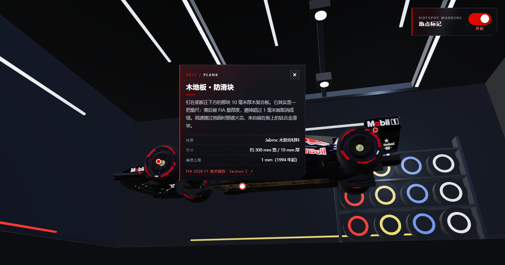

# RB22 · Web3D

**浏览器里的 F1 赛车 3D 展示页**：加载红牛 RB22（2026 赛季）车模，360° 拖拽旋转，
点击车身部件弹出科普信息卡。个人作品集 / 学习项目。

[](https://vuejs.org/)
[](https://threejs.org/)
[](https://www.typescriptlang.org/)
[](https://vite.dev/)
[](#ai-coding-说明)



---

## 这是什么

一个纯前端的 Web3D 单页应用。打开页面后：

1. 车模带着进度条加载，进入一间程序化生成的「车队工房」展示间；
2. 鼠标 / 手指拖拽可以 360° 环绕赛车，滚轮 / 双指缩放，镜头甚至可以沉到车底；
3. 车身 8 个部件上有发光圆点，点击弹出该部件的科普卡片（标题、正文、规格、出处）；
4. 右上角开关可以一键隐藏所有热点，回到纯展示模式。

**它解决的不是「放一个 3D 模型」**，而是三个具体问题：

- 35.8 MB 的未压缩车模如何在浏览器里稳定加载、居中、取景；
- 28 万三角形不能每帧 raycast，热点拾取如何做到不拖慢渲染；
- 没有 HDRI、没有美术资源，如何只用基础几何 + canvas 贴图搭出有层次的展厅。

---

## 功能一览

| 模块 | 能力 |
| --- | --- |
| 车模 | GLTF 加载、真实进度、包围盒居中、按包围球自动取景、各向异性过滤 |
| 相机 | OrbitControls、360° 方位、可沉到车底、距离限位、阻尼 |
| 热点 | CSS2D 圆点（真实 `<button>`）、隐形代理球 Raycaster、拖拽阈值、背向淡出 |
| 信息卡 | 跟随投影、贴边收位、上方放不下自动翻到下方、窄屏贴底抽屉、Esc / 空白关闭 |
| 展示间 | 13.6 × 13.6 封闭工房：环氧地坪、品牌墙、灯桁架、轮胎墙、工具墙、计时屏 |
| 光照 | SpotLight 光池 + RoomEnvironment 环境反射 + 阴影 + 雾 |
| 兜底 | WebGL 2 预检、加载进度、解析提示、失败原因 + 重新加载、显卡上下文丢失提示 |
| 开发工具 | `?pick` 取点、`preview.html` 无车模布景预览（不进生产包） |
| 适配 | `prefers-reduced-motion`、窄屏抽屉、resize 自适应 |

热点覆盖：**Halo、前翼、尾翼、动力单元、轮胎、悬挂、底板、车底木地板（防滑块）**。

---

## 技术栈

| 层 | 选型 | 说明 |
| --- | --- | --- |
| 构建 | **Vite 6.4** | 静态站点，`npm run build` 产出 `dist/` |
| 语言 | **TypeScript 5.9（strict）** | 禁止 `any`，类型检查用 `vue-tsc` |
| 3D | **Three.js r187（原生 API）** | 不使用 R3F / drei / tresjs 等封装层 |
| UI | **Vue 3.5**（SFC + `<script setup>`） | 只负责 DOM 层，不参与 3D 渲染 |
| 模型 | **glTF 2.0 / GLB** | `GLTFLoader`，当前未压缩（PNG 贴图） |
| 相机 | `OrbitControls` | 不手写球面坐标控制器 |
| 标记 | `CSS2DRenderer` | HTML 做热点，不用 3D Mesh |
| 拾取 | `Raycaster` | 只打不可见代理球，不打全模型 |
| 环境光 | `RoomEnvironment` + PMREM | 程序化环境贴图，不依赖 HDRI 文件 |
| 样式 | 手写 CSS + BEM | 不引入 UI 组件库 |
| 部署 | 静态托管（待部署） | Vercel / Netlify 均可 |

运行环境：**Node ≥ 20**（当前验证 20.10.0）。

---

## 快速开始

```bash
npm install
npm run dev        # http://localhost:5173
```

| 命令 | 作用 |
| --- | --- |
| `npm run dev` | 启动开发服务器 |
| `npm run build` | `vue-tsc --noEmit` 类型检查 + 产出 `dist/` |
| `npm run preview` | 本地预览构建产物 |
| `npm run typecheck` | 只做类型检查 |

> `public/models/rb22.glb` 已随仓库提交（36 MB）。首次 `clone` 后无需额外下载模型。

### 热点取点（开发期）

```bash
npm run dev
# 浏览器打开 http://localhost:5173/?pick
```

点车身取点，面板给出 `position` / `normal` 两行，粘到
[`src/config/hotspots.ts`](src/config/hotspots.ts) 对应条目即可。
取点工具只在 DEV 下动态加载，生产包不包含。

---

## 架构

Three.js 与 Vue 的边界是**单向**的：Three 侧不认识 Vue，只通过 composable 把
「选中了哪个热点 / 它在屏幕上的位置」暴露成 `ref`，再由 Vue 渲染卡片。

```
App.vue
 ├─ SceneManager        场景 / 相机 / 两个 renderer / 唯一 RAF 循环 / resize / dispose
 │   ├─ Showroom        程序化展示间（房间 + 道具 + 每帧更新）
 │   ├─ ModelLoader     GLTF 加载 / 居中 / 归一化 / 取景
 │   └─ HotspotSystem   圆点 DOM + 代理球拾取 + 背向淡出
 └─ useHotspots         Vue ↔ Three 的唯一桥
     ├─ HotspotCard     信息浮窗（只操作 DOM）
     └─ HotspotToggle   热点总开关
```

```
src/
├── config/        # 唯一数据源：热点、场景、模型、展示间、交互常量
├── core/          # Three.js 逻辑：SceneManager / ModelLoader / Showroom / HotspotSystem
│   └── props/     # 一件道具一个 builder，注册表驱动
├── composables/   # Vue ↔ Three 桥
├── ui/            # 纯 DOM 组件（禁止 import three）
├── dev/           # ?pick 取点、preview.html 布景预览（不进生产包）
└── types/         # Hotspot 等类型定义
```

完整目录、模块边界与编码规范见 [PROJECT_CONTEXT.md](PROJECT_CONTEXT.md)。

---

## 性能与取舍

| 项 | 现状 | 取舍 |
| --- | --- | --- |
| 车模 | 35.8 MB，26 张 4096² PNG，显存约 330 MB | 保画质优先；压缩版（10.5 MB，Draco + KTX2）留在 `.tools/` 备选 |
| JS 产物 | 767 kB / gzip 207 kB（three + vue） | 单 chunk，暂未拆包；Phase P2 处理 |
| 三角形 | 约 28 万 | **不做每帧全模型 raycast**，只打代理球 |
| 热点遮挡 | 法线点积近似 | 换取拖拽稳定性；不做真实深度遮挡 |
| 相机 | 360° + 车底 | 相机低于地面时用裁剪面切掉地板 / 展台，避免挡视线 |
| 背景 | 程序化几何 + canvas 贴图 | 0 额外下载，不依赖 HDRI / 外部贴图 |

---

## AI Coding 说明

**本项目是一个 AI Coding（AI 辅助编程）实践项目。** 从架构文档、代码实现到 README，
均在 AI 编程助手协作下完成；所有架构决策、技术选型与最终验收由作者本人负责。

| 环节 | 作者 | AI 编程助手 |
| --- | --- | --- |
| 产品定位 / 范围 | 确定目标、非目标与验收线 | 整理成文档、指出遗漏 |
| 架构 | 定技术栈、模块边界、禁止事项 | 按约束实现、重构、补注释 |
| 3D 实现 | 验收画面与手感 | 场景、材质、光照、热点系统代码 |
| 文档 | 确认事实与数据 | 撰写 README、架构说明、交付路线图 |
| 验收 | 浏览器实测、真机确认 | 类型检查、构建、静态自查 |

因此仓库里保留了 [`PROJECT_CONTEXT.md`](PROJECT_CONTEXT.md) 这类「写给 AI 的约束文档」——
它既是协作规范，也是这个项目区别于「让 AI 随便生成一版」的地方：
**约束先行，AI 在边界内实现，人做最终判断。**

---

## 路线图

从「能跑的作品集」到「可交付的线上作品」，按 P0 → P3 推进：

- **P0 交付闭环**：部署、初始化兜底、联系方式、favicon / OG、素材授权
- **P1 体验质量**：移动端真机、画质分级、模型压缩、可访问性、内容校对
- **P2 工程化**：CI、lint、测试、埋点、错误上报、拆包
- **P3 呈现**：case study、演示 GIF、英文摘要

详见 [docs/DELIVERY-PLAN.md](docs/DELIVERY-PLAN.md)。

---

## 已知事项

- **模型未压缩**：首屏需要下载 35.8 MB，弱网 / 低端手机会慢；压缩方案见上表。
- **移动端取景**：`frameObject` 目前只按竖直视野计算，竖屏可能偏紧，待 P1 修正。
- **热点遮挡是近似**：按法线淡出，不做真实遮挡，避免每帧 raycast。
- **headless 截图受限**：26 张 4096² 贴图会让软件渲染崩掉，自动化截图只能跑
  `preview.html`（不加载车模），完整画面靠人工验收。
- **素材授权**：车模来源、Red Bull / F1 商标使用边界、署名要求待确认；
  公开部署前需补页面致谢。
- **代码协议**：暂未声明 LICENSE（保留所有权利），作者确认后再定。

---

## 致谢

- 车模：待补充来源与作者
- 灵感：F1 官方转播包装、红牛车队工房视觉
- 文档与实现：AI 编程助手（DeepSeek Harness）协作完成

## License

待定。在明确协议前，代码与素材保留所有权利。
