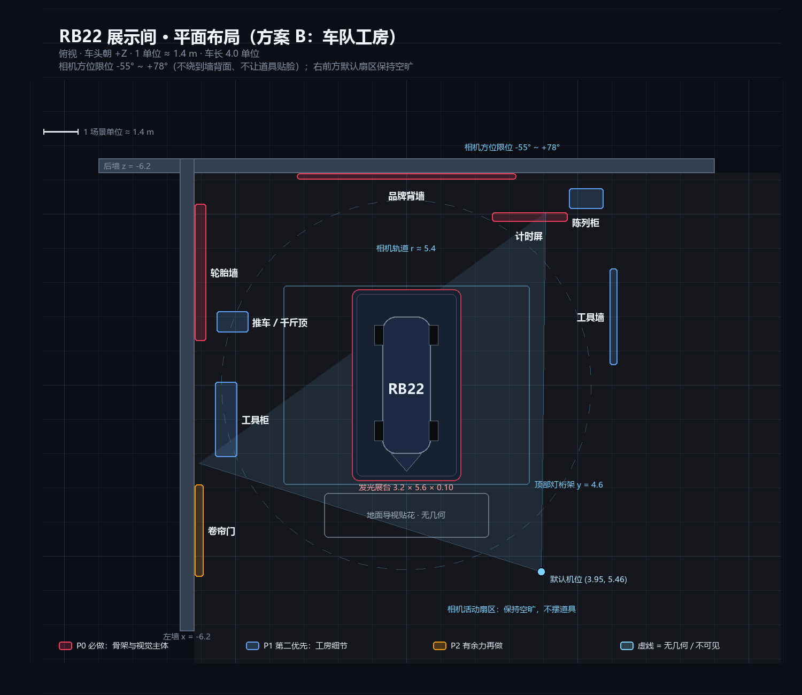

# RB22 展示间改造计划（方案 B · 车队工房）

> **状态：已实施，部分方案在验收后调整过。** 本文档保留原始规划做过程记录。
>
> 后续验收变更（2026-11-04）：相机改为 **360° 自由环绕 + 车底视角**（地板/展台按相机高度
> 自动裁剪）、默认取景 `padding` 收到 0.88、地面换成**白色无缝环氧地坪**、
> 工具车从车右前方挪到**后墙右下角**。本文 §4 规则 1 与 §6 里的相机方位角限位属于历史方案，
> 现在以源码和 `PROJECT_CONTEXT.md` §5.6 为准。
>
> 相关：[PROJECT_CONTEXT.md](../PROJECT_CONTEXT.md)（架构硬约束）、[平面布局图](./showroom-layout.png)

---

## 1. 目标

把现在的「一台车 + 两堵黑墙」改成一个工位大小的车队工房（可用范围约 8 × 10 m）：

- 车停在发光展台上，背后是品牌背墙，左侧轮胎墙，右侧工具墙，旁边计时屏与陈列柜；
- 顶光打下来形成光池，四周压暗进雾里，画面有前景 / 中景 / 背景三层；
- 全是程序化几何 + canvas 贴图，**不新增下载资源、不新增依赖**。

**可量化的验收线**（不是感觉）：

| 指标 | 目标 |
| --- | --- |
| 默认机位可见道具 | ≥ 6 件（现在 0 件） |
| 车身与背景的亮度差 | ≥ 1.5 档（现在几乎同色） |
| 画面上/下/左/右边缘 | 不出现「空墙 + 空地板」 |
| 桌面 1080p 帧率 | ≥ 55 fps |
| draw call | ≤ 160 |
| 新增下载体积 | 0 MB（可选 GLB 时 ≤ 3 MB） |

---

## 2. 现状诊断

| # | 问题 | 依据 |
| --- | --- | --- |
| 1 | 道具全在车**后面** 6 米外 | 轮胎堆 `(-4.9,-6.2)(-5.6,-4.9)(5.3,-6.4)`、工具柜 `(-5.4,-3.2)`；机位在右前方，全被车挡住或掉出画面 |
| 2 | 光比太平 | `hemisphere 0.5` + 环境贴图整体铺亮 + 主光 2.8，墙/地/车亮度接近 |
| 3 | 材质单一 | 全部 `MeshStandardMaterial` 深色板，没有金属 / 玻璃 / 橡胶 / 漆面的对比 |
| 4 | 没有信息 | 没有字、编号、标识；真实感很大程度靠这些细节 |
| 5 | 车顶满画面 | `padding 0.95` 小于 1，车贴着画面边缘，视觉上没有「房间」 |

---

## 3. 视觉基调

**色板**

| 用途 | 色值 |
| --- | --- |
| 背景 / 雾 | `#0b0e14` |
| 墙面 | `#12161d` |
| 车队红 | `#e10600` |
| 车队黄 | `#ffcf00` |
| 金属（工具 / 桁架） | `#8a93a3` |
| 屏幕青白 | `#d7e6ff` |

**材质配比**（画面面积占比，用来防止「满屏发光」）：哑光 70% / 金属 20% / 橡胶 8% / 发光 2%。
**光比**：主光 : 环境 ≈ 4 : 1，画面四角压到 15% 亮度以下。
**构图**：车占画面宽 55~65%，地平线在高度 45%。
**禁止**：彩虹色、满屏霓虹、超过 3 处高亮发光体（会盖掉车漆反射）。

---

## 4. 空间布局



坐标系：Y 轴向上，车长轴 = **Z**，车头朝 **+Z**，原点在车中心正下方地面。
比例：1 场景单位 ≈ 1.4 m；车归一化后 4.0（长）× 1.41（宽）× 0.89（高），包围球半径 ≈ 2.16。

| 物件 | 位置 (x, z) | 尺寸 (X × Z) | 高度 | 优先级 |
| --- | --- | --- | --- | --- |
| 发光展台 | (0, 0) | 3.2 × 5.6 | 0.10 | P0 |
| 品牌背墙（贴后墙） | (0, -6.10) | 6.4 × 0.06 | 3.2（底 0.55） | P0 |
| 轮胎墙（贴左墙） | (-6.05, -3.30) | 0.20 × 4.0 | 2.6 | P0 |
| 计时屏（落地） | (3.60, -4.90) | 2.2 × 0.15 | 0.9（屏底 1.5） | P0 |
| 顶部灯桁架 | (0, 0) | 7.2 × 5.8 | y = 4.6 | P0 |
| 工具墙（落地支架） | (6.00, -2.00) | 0.22 × 2.8 | 2.0 | P1 |
| 陈列柜（头盔 + 奖杯） | (5.25, -5.45) | 1.0 × 0.6 | 2.0 | P1 |
| 工具柜（现有，重摆） | (-5.25, 1.00) | 0.65 × 2.2 | 1.5 | P1 |
| 推车 / 千斤顶 | (-5.05, -1.85) | 0.9 × 0.6 | 1.1 | P1 |
| 地面导视贴花 | (0, 3.80) | 4.8 × 1.3 | — | P2 |
| 卷帘门（贴左墙） | (-6.05, 4.25) | 0.15 × 2.7 | 3.0 | P2 |

**三条布局规则**（后面加东西都按这个来）：

1. **相机限位**：方位角锁在 **-55° ~ +78°**（以 +Z 为 0°），俯仰 5° ~ 30°。原因是硬约束：
   - 两堵墙都是 `PlaneGeometry` 单面材质，相机一旦绕到墙外，墙会「消失」；
   - 后墙/左墙距离 6.2，而相机默认半径约 7，不加限位必然穿墙；
   - 限位之后，所有道具永远在背景，不会贴脸挡车。
   这条代价是**不能 360° 转**，但换来「任何角度都是成品画面」。一行配置可关，Step 3 你可以对比后再定。
2. **默认机位所在扇区（右前，+X +Z）保持空旷**，只放地面贴花，不放立体物。
3. **靠墙分层**：左墙 = 橡胶（轮胎墙 / 卷帘门），后墙 = 品牌 + 屏幕，右前 = 金属（工具墙 / 陈列柜）。让每个方向有不同材质，转动时画面才不重复。

---

## 5. 道具清单与做法

| 道具 | 做法 | 三角形 | draw call | 备注 |
| --- | --- | --- | --- | --- |
| 发光展台 | `BoxGeometry` + 4 条 LED 边条（emissive） | < 100 | 5 | 车整体抬高 0.10，阴影落在台面上 |
| 品牌背墙 | 平面 + canvas 贴图（2048×1024）+ emissive | 4 | 3 | 抽象车队图形 + 斜纹 + 「RB22」字号，**不直接抄真实 logo** |
| 灯桁架 | 4 根 `BoxGeometry` + 2 个灯罩 | < 100 | 5 | 只做造型，真实照明靠 §6 |
| 轮胎墙 | `InstancedMesh`（复用现有轮胎几何）+ 2 立柱 + 横梁 | ~1.2k | 5 | 12 只，三种胎圈色（红 / 黄 / 蓝）用 `instanceColor` |
| 计时屏 | 平面 + canvas 动态贴图（1024×512）+ 框 + 支架 | < 200 | 5 | 每 500ms 刷新一次，`SceneManager.onFrame` 驱动 |
| 工具墙 | 穿孔板（canvas 1024×1024）+ 8 件工具 | ~4k | 12 | 气动扳手、扭矩扳手、套筒、备件盒 |
| 陈列柜 | 5 块板 + `MeshPhysicalMaterial` 玻璃 + 头盔 + 奖杯 | ~6k | 9 | 奖杯用 `LatheGeometry` |
| 推车 / 千斤顶 | 2 个轮 + 框 + 液压杆 | ~1.5k | 6 | 工房「有人用过」的痕迹 |
| 卷帘门 | 平面 + 贴图（512）+ 门缝光条 | < 200 | 3 | 门底一条光，制造纵深 |
| 地面贴花 | 平面 + alpha 贴图（1024×1024） | 2 | 1 | 用 `polygonOffset` 防 z-fighting |
| 尘埃 | `Points`（2000 点，additive） | 2000 | 1 | 缓慢下沉 + 轻微漂移 |

合计新增约 **55 draw call / 1.5 万三角形 / 19 MB 纹理内存**，下载量 0。

---

## 6. 灯光改造

| 项 | 现在 | 改成 | 为什么 |
| --- | --- | --- | --- |
| 半球光 | 0.50 | **0.20** | 环境压暗，才有「光池」 |
| 环境贴图强度 | 1.0 | **0.65** | 保留车漆反射，但不让墙一起被照亮 |
| 主光 | `DirectionalLight` 2.8 | **`SpotLight` 200 cd，angle 0.52，penumbra 0.7，decay 2**，位置 (2.4, 7.4, 4.0) | 平行光没有「光池」边缘；聚光才有展厅感 |
| 补光 | 0.8 | 0.45 | 只提暗部，不参与造型 |
| 轮廓光 | 1.6 | **2.4** | 背墙变亮后，车必须更亮地从背景里剥出来 |
| 灯带溢光 | 无 | **2 个 `PointLight`**（左墙 / 右前，intensity 6，distance 7） | 让灯带真的「照」到地面和墙，而不是一条死亮的色块 |
| 曝光 | 1.1 | 1.05 | 配合更低的整体环境 |
| 雾 | 7 / 32 | **9 / 30** | 后墙 10 米外才有雾，近处不发灰 |
| 阴影 | 主光 2048，extent 6 | extent **7** | 要把展台和工具一起包进阴影相机 |
| 控制器限位 | 无 | azimuth **-55°~+78°**，polar **60°~85°**，距离 2.6~9.1 | 不让人转到墙背面看到「空舞台侧面」，也避免道具挡镜头（理由见 §4 规则 1） |

相机同步调整：`fov 45 → 40`，`padding 0.95 → 1.10`，默认机位 (5.2, 2.6, 7.2) → 实际落点约 **(3.95, 2.50, 5.46)**，`maxDistanceRatio 5 → 4.2`（别飞出房间）。

---

## 7. 代码结构改动（提议，待你确认）

```
src/config/showroom.ts          # 房间 + 道具摆放清单（garage.ts 的空间段并入这里）
src/core/Showroom.ts            # 组装入口，替代 createPitGarage()
src/core/ProceduralTextures.ts  # 品牌墙 / 计时屏 / 穿孔板 / 地贴 的 canvas 生成
src/core/props/
  ├─ plinth.ts        ├─ brandWall.ts    ├─ tireWall.ts
  ├─ toolWall.ts      ├─ timingScreen.ts ├─ trophyCase.ts
  ├─ pitCart.ts       ├─ rollUpDoor.ts   ├─ truss.ts
  └─ index.ts         # kind → builder 注册表
```

**配置形态**（加道具 = 加一行）：

```ts
export type PropKind =
  | 'plinth' | 'brand-wall' | 'tire-wall' | 'tool-wall'
  | 'timing-screen' | 'trophy-case' | 'pit-cart'
  | 'roll-up-door' | 'truss' | 'floor-decal';

export interface PropPlacement {
  readonly kind: PropKind;
  readonly position: Vec3Tuple;
  readonly rotationY: number;
  readonly scale?: number;
}
```

**约束**（对齐 PROJECT_CONTEXT §4 / §6）：

- 每个 builder 是纯函数 `(config, placement) => Object3D`，不互相 import；
- 所有尺寸、颜色、坐标进 `showroom.ts`，逻辑里不出现魔法数字；
- 只有 `Showroom` 需要每帧更新（计时屏、尘埃），通过已有的 `SceneManager.onFrame` 注册，不改渲染循环；
- 不引入任何新依赖；不 import `three` 到 `ui/`。

启动时会在 `PROJECT_CONTEXT.md` §8 追加一条 **Phase 2.5 — 展示间布景**，Phase 3 顺延。

---

## 8. 分步实施

| Step | 内容 | 预计 | 交付 |
| --- | --- | --- | --- |
| 0 | 校准：包围盒确认长轴与车头方向；记录现状 draw call / 三角形；拍 4 张基线图 | 0.5 天 | 校准结论 + 基线数据 |
| 1 | 灯光改造 + 展台 + 品牌背墙 + 灯桁架 + 相机取景 | 1 天 | 骨架截图 |
| 2 | 轮胎墙 + 工具墙 + 计时屏（含动态刷新） | 1 天 | 中景截图 + 性能记录 |
| 3 | 陈列柜 + 推车 / 千斤顶 + 卷帘门 + 地面贴花 + 尘埃 | 1 天 | 三档机位截图 |
| 4 | 打磨：曝光 / 雾 / 阴影、移动端降级、README 与 PROJECT_CONTEXT 更新 | 0.5 天 | 终版 + 文档 |

合计 **4~4.5 天**（不含你验收反馈的往返）。

**每一步的验收标准**：

- Step 1：车与背墙的明暗分离明显；地面有明确光池；车不悬空、阴影落在台面上。
- Step 2：默认机位画面四角都有东西；帧率与 draw call 记录在案；计时屏数字会跳。
- Step 3：转一圈不穿模、不挡车（车身被遮挡 < 15%）；拉近拉远都成立。
- Step 4：`npm run build` 通过、`vue-tsc --noEmit` 零错误、移动端能打开。

**每步结束我都会停下来**，把改动文件列给你，等你看过再进下一步。

---

## 9. 性能预算

| 项 | 现在 | 目标上限 |
| --- | --- | --- |
| 首屏下载 | 35.8 MB | ≤ 35.8 MB（布景不加资源） |
| draw call | ≈ 47 | ≤ 160 |
| 三角形 | ≈ 28 万 | ≤ 32 万 |
| 纹理内存 | ≈ 330 MB | ≤ 360 MB |
| 帧率（1080p 桌面） | 未测 | ≥ 55 fps |

超预算时的降级顺序：尘埃 → 陈列柜玻璃 → 工具数量 → 计时屏刷新率。

---

## 10. 素材与授权

默认**全部程序化**，不下载外部模型，理由：体积为 0、授权为零、风格统一、改配色改坐标都只动配置。

如果之后想要「更真」，按这个优先级接：

1. **Poly Haven**（CC0，可商用、免署名）→ 工具、箱体、椅子；
2. **Sketchfab**（筛 CC-BY，必须署名）→ 头盔、方向盘、奖杯；
3. **HDRI**（Poly Haven）→ 换掉程序化墙，但会丢掉「车队标识可控」，需重做雾和墙，单独立项。

授权红线：红牛 / 倍耐力 / F1 的标识都是商标，作品集展示问题不大，但**公开部署的页脚要写素材来源与署名**，且不做成商业宣传物料。

---

## 11. 风险与回滚

| 风险 | 影响 | 对策 |
| --- | --- | --- |
| 车模本身 330 MB 显存 + 新增纹理 | 低端集显 / 手机崩 | 纹理尺寸封顶 2048；移动端关尘埃、跳过玻璃折射 |
| 我这台机器**做不了 headless 截图** | 我无法自查画面 | 已实测：swiftshader 渲染这份模型会 renderer 崩溃。每步靠你在浏览器里看，我按反馈改 |
| 商标 | 公开部署风险 | 品牌墙用抽象图形 + 页脚署名 |
| 程序化道具「塑料感」 | 观感廉价 | 用 `three/addons` 的 `RoundedBoxGeometry` 倒角 + 粗糙度/金属度分层 |
| 取景变化导致热点坐标作废 | Phase 3 返工 | 布景定稿后再标热点（顺序见 §12） |
| 道具转一圈挡车 | 交互体感差 | 见 §4 规则 1：相机方位角限位 -55°~+78°，Step 3 可对比关闭后的效果 |

**回滚**：布景集中在 `Showroom.ts` + `config/showroom.ts`，删掉这两个文件、`App.vue` 换回 `createPitGarage()` 即恢复原状；开发在独立分支 `feat/showroom` 上做。

---

## 12. 待你确认的默认值

下面这些我**先按「默认」写进计划**，你不反对就照这个做：

| 决策 | 默认 | 备选 |
| --- | --- | --- |
| 外部素材 | 纯程序化，不下载 | Step 4 再评估 2~3 个 CC0 GLB |
| 机位 | 限位环绕（-55°~+78°），不做预设切换 | 360° 自由旋转（需改双面墙）/ 预设机位 + 缓动运镜 |
| 手机端 | 「能打开、不崩」即可 | 精修到可用 |
| Bloom 后处理 | 不做（填充率 +30%） | 做，灯带会发光溢出 |
| 品牌墙 logo | 抽象化（红黄斜纹 + RB22 字样） | 用真实车队标识 |
| 顺序 | 布景先定稿，Phase 3 热点后做 | 先做热点 |

---

## 13. 启动清单（给你改主意用）

你说「开始」之后我会依次做：

1. 复述本计划，确认 Step 0 范围；
2. 建分支 `feat/showroom`；
3. Step 0 校准 → 停下来给你数据；
4. 之后每 Step 一次交付 + 一次验收，不一次性做完；
5. 全部完成后更新 `README.md` 与 `PROJECT_CONTEXT.md`，再合并。

---

## 14. 实施偏差记录（Step 1–2 完成后回填）

原计划是按「没有画面反馈」写的，实际用 `/preview.html` 在软件渲染下出了图，
下面这些参数被画面推翻了，**以本节为准**：

| 项 | 计划 | 实际 | 原因 |
| --- | --- | --- | --- |
| 品牌墙位置 | (0, -6.1)，6.4 宽 | **(-1.0, -6.1)，7.0 宽** | 相机在右前 36°，墙上的内容会整体偏右，「22」和计时屏被画面右边缘裁掉 |
| 品牌墙高度 | 3.2 | 3.3 | 同上，让字标和赞助条的比例更稳 |
| 桁架高度 | y = 4.6 | **y = 3.5** | 4.6 完全在画面外；3.5 是「能看见 + 不压头」的临界值 |
| 桁架纵深 | 5.8 | 4.6，中心后移到 z = -1.2 | 近端横梁离相机太近会糊满画面顶部 |
| 取景 | 注视点 = 车心 | **注视点上移 0.45**（`targetOffsetY`） | 死盯车心时画面全给地板和展台，背墙/桁架全在画外 |
| 计时屏 | (3.6, -4.9) | **(2.7, -4.7)** | 3.6 正好被右边缘裁掉；2.7 是画面右边界（约 3.0）内的极限 |
| 工具墙 | 右前方 (6, -2) | 位置未动，但**默认机位看不到** | 它在车的侧面，只有转到最左（-55°）才会入画；Step 3 需要重定位或改成工作台 |
| 展台台面 | roughness 0.22 | 0.32 | 太光滑会在台面上反出主光一个大白斑 |

**新增的开发工具**：`preview.html` + `src/dev/previewShowroom.ts`。
整机 headless 渲染不了车模（26 张 4096² 贴图会让 swiftshader 崩），
去掉车之后就能出图，用来核对构图、光比、道具位置。不参与构建。

---

## 15. 第二轮改动（按作者反馈调整）

作者看过第一版之后提的修改，已实现：

| 项 | 原来 | 现在 | 原因 |
| --- | --- | --- | --- |
| 背景墙 | 营销向品牌墙（RED BULL RACING + 22） | **7×3.3 赛事大屏**：场次 / 圈数 / 最快圈 / 三段扇区 / 测速点 / 圈速榜 / 车号 3 | 要「F1 车库」的信息感，不要宣传物料 |
| 落地计时屏 | 独立 2.2×0.9 小屏 | **删除**，圈速榜并进大屏右侧 | 作者要求「原来的计时展示不要了」 |
| 车号 | 22 | **3**（水印、PIT 3、底栏 #3）；`RB22` 车型代号保留 | 作者指定 |
| 房间 | 两面墙 + 无限地坪 | **13.6×13.6 封闭房间**：四面墙 + 天花板 + 四边灯带 | 相机一侧太空旷，封闭后任何角度都不露虚空 |
| 相机 | fov 40，距离 6.95 | **fov 45，距离 5.64，maxDistance 6.2** | 房间要装得下、又不让相机贴墙 |
| 主光 | y=7.4（在房间外） | **y=4.6**，强度 95 | 天花板 5.2，灯必须在室内 |
| 工具墙 | x=6，默认机位看不到 | 移到右墙 x=6.65 | 封闭房间后它成了右墙的固定陈设 |
| 右前景 | 空地板 | **移动工具车**（1.75, 0, -0.25） | 填住默认机位右下角 |
| 轮胎 | — | 保持程序化（作者没找到合适的 F1 胎模型） | 后续可替换 |

**大屏版式注意**：顶部 150px 留了安全区。灯桁架会从前面横过墙顶，
正文写进这个区域会被挡掉——这是渲染出图之后才发现的。
